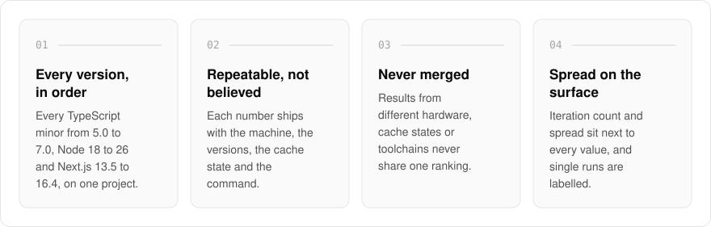
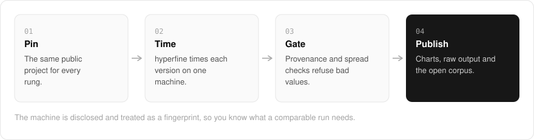

  <picture>
    <source media="(prefers-color-scheme: dark)" srcset=".github/assets/hero-dark.png">
    
  </picture>

<h1 align="center">run.me.at</h1>

<strong>Toolchain benchmarks by me.</strong>

  
  
  

  <a href="https://run.me.at">Website</a> ·
  <a href="#features">Features</a> ·
  <a href="#how-it-works">How it works</a> ·
  <a href="#screenshots">Screenshots</a> ·
  <a href="#built-with">Built with</a>

Most benchmark charts give you one number with no machine, no versions and no way to check it. I built run.me.at as a first-party bench: I run the suites on hardware I own and disclose, then publish each number with the machine, the toolchain versions, the cache state and the command that produced it, so a run can be repeated rather than believed. The front page is the toolchain ladders: every TypeScript minor from 5.0 to 7.0, Node 18 to 26 (and Bun), and Next.js 13.5 to 16.4 with webpack and Turbopack, each timed on the same pinned public project with the raw hyperfine output beside every chart. It is not a leaderboard, nothing on it is vendor-attested, and nothing is for sale.

  <picture>
    <source media="(prefers-color-scheme: dark)" srcset=".github/assets/overview-dark.svg">
    
  </picture>

## Why run.me.at

| The usual benchmark chart | run.me.at |
| --- | --- |
| One number, no context | The machine, versions, cache state and command with every value |
| Different hardware mixed into one ranking | Results partitioned by hardware, cache state and toolchain |
| A single figure that hides the spread | Iteration count and spread next to every value |
| Run or sponsored by a vendor | First-party, on hardware I own, with nothing for sale |

## Features

- **Toolchain ladders**: TypeScript 5.0 to 7.0, Node 18 to 26 and Bun, and Next.js 13.5 to 16.4 with webpack and Turbopack, drawn in version order on one pinned project, with the raw hyperfine output published.
- **The bench index**: corpus counts plus every published measurement and comparison.
- **Methodology**: each honesty rule is paired with the function in the code that enforces it.
- **Machines and versions**: the hardware, environments and what a comparable run needs, treated as a fingerprint.
- **Partitioned results**: numbers from different hardware, cache states or toolchain versions are never merged into one ranking.
- **Spread on the surface**: every value carries its iteration count and spread next to the number, and single runs are labeled as such.
- **Publishing gates**: provenance, distribution and stored-value checks refuse a value before it can reach a page.
- **The fleet dashboard**: `/fleet` is the monorepo behind these apps measuring its own builds.
- **Open corpus**: `/corpus.json` exposes the whole corpus in the shapes the pages render from.

## How it works

  <picture>
    <source media="(prefers-color-scheme: dark)" srcset=".github/assets/flow-dark.svg">
    
  </picture>

Every rung of a ladder does the same job on the same pinned public project, so the only thing that changes is the version. hyperfine times each version on one disclosed machine, and the run is recorded with its machine fingerprint, versions, cache state and command. Publishing gates check provenance, distribution and stored values before anything reaches a page, which renders the charts, the raw output and the open corpus.

## Screenshots

<table>
  <tr>
    <td width="50%"><picture><source media="(prefers-color-scheme: dark)" srcset=".github/assets/methodology-dark.png"></picture> Methodology: each promise and the code that enforces it.</td>
    <td width="50%"><picture><source media="(prefers-color-scheme: dark)" srcset=".github/assets/machines-dark.png"></picture> Machines and versions: what a comparable run needs.</td>
  </tr>
  <tr>
    <td width="50%"><picture><source media="(prefers-color-scheme: dark)" srcset=".github/assets/fleet-dark.png"></picture> Fleet: the monorepo measuring its own builds.</td>
  </tr>
</table>

## Built with

  
  
  
  

- Next.js 16 (App Router) and React 19
- TypeScript
- Tailwind CSS 4
- hyperfine for the toolchain ladders
- A typed benchmark corpus committed alongside the code, also served as `/corpus.json`

## Part of the me.at family

run.me.at is one of my [`*.me.at`](https://me.at) apps. They share one design system, account, and app shell. Development happens in a private monorepo; this repository is the project's public-facing home.

## License

Source-available. See [LICENSE](LICENSE).
