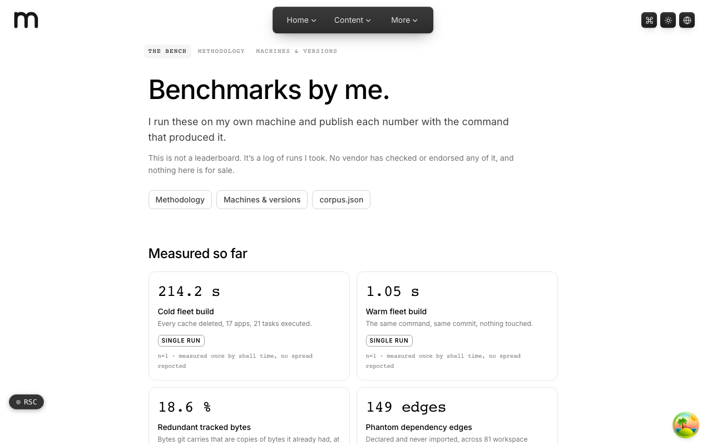
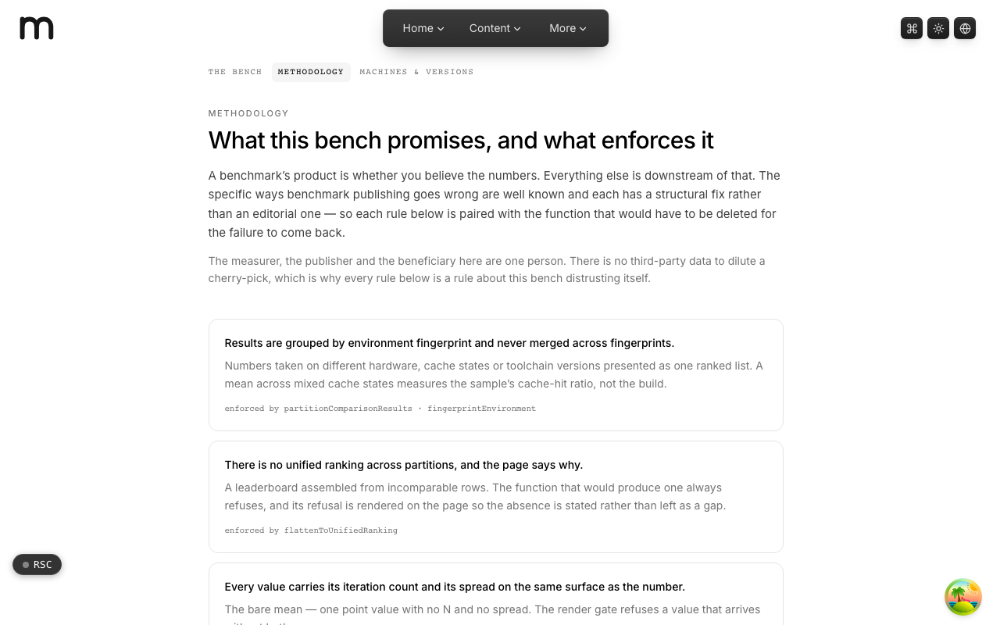
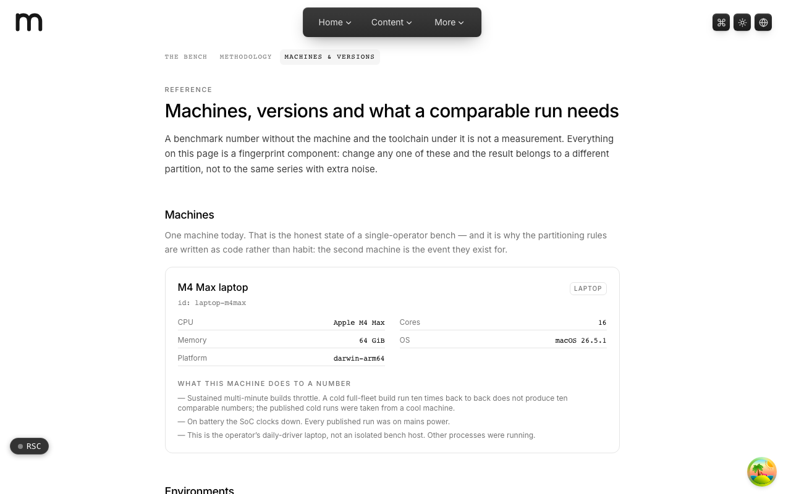

  <picture>
    <source media="(prefers-color-scheme: dark)" srcset=".github/assets/hero-dark.png">
    
  </picture>

# run.me.at

Benchmarks by me.

run.me.at is a first-party benchmark bench. I run the suites on hardware I own and disclose, then publishes each number with the machine, the toolchain versions, the cache state and the command that produced it, so a run can be repeated rather than believed. It covers LLMs, ML models and the TypeScript toolchain. It is not a leaderboard, nothing on it is vendor-attested, and nothing is for sale.

**Live:** [run.me.at](https://run.me.at)

## Features

- **The bench index**: corpus counts plus every published measurement and comparison.
- **Methodology**: each honesty rule is paired with the function in the code that enforces it.
- **Machines and versions**: the hardware, environments and what a comparable run needs, treated as a fingerprint.
- **Partitioned results**: numbers from different hardware, cache states or toolchain versions are never merged into one ranking.
- **Spread on the surface**: every value carries its iteration count and spread next to the number, and single runs are labeled as such.
- **Publishing gates**: provenance, distribution and stored-value checks refuse a value before it can reach a page.
- **Open corpus**: `/corpus.json` exposes the whole corpus in the shapes the pages render from.

## Screenshots

<table>
  <tr>
    <td width="50%"><picture><source media="(prefers-color-scheme: dark)" srcset=".github/assets/methodology-dark.png"></picture> Methodology: each promise and the code that enforces it</td>
    <td width="50%"><picture><source media="(prefers-color-scheme: dark)" srcset=".github/assets/machines-dark.png"></picture> Machines and versions: what a comparable run needs</td>
  </tr>
</table>

## Built with

- Next.js 16 (App Router) and React 19
- TypeScript
- Tailwind CSS 4
- A typed benchmark corpus committed alongside the code, also served as `/corpus.json`

## Part of the me.at family

run.me.at is one of my [`*.me.at`](https://me.at) apps. They share one design system, account, and app shell. Development happens in a private monorepo; this repository is the project's public-facing home.

## License

See [LICENSE](LICENSE).
